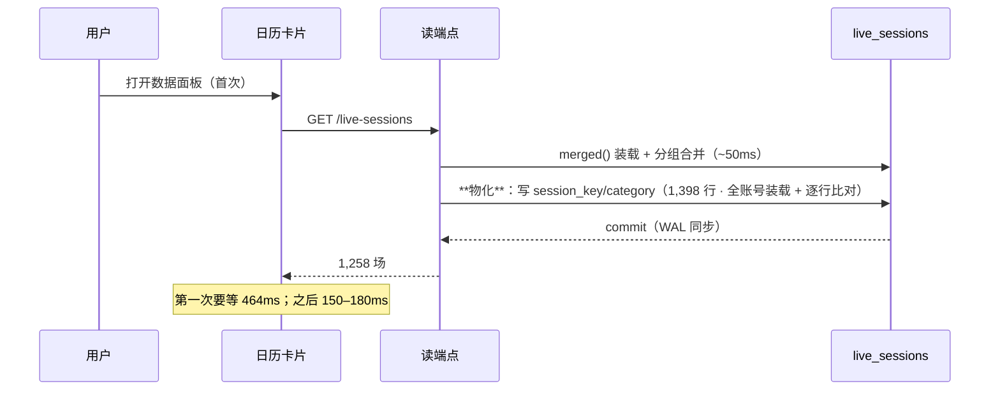

# 473-20261013 第一次打开日历为什么要等一下：读端点不该写库

> 用户问：「为什么现在第一次打开数据面板看到直播日历卡片会需要加载一小会才出现内容」。
> 量下来是**真问题**，而且**是我上一批（f017）引入的** —— 冷热差 464ms vs 170ms。

## 一、先量：冷的那一次贵在哪

真机账号 22（表内 1,398 行）· 库副本 `session_key` 全空（= 从未物化过）：

| | `/live-sessions` | `/live-type-stats` |
|---|---|---|
| **第 1 轮**（冷：要物化） | **464 ms** | **188 ms** |
| 第 2–4 轮（热） | 148–170 ms | 132–144 ms |

前端在**首次加载且还没有任何场次**时才显示加载块（`LiveCalendar.tsx`：
`loading && sessions.length === 0`）—— 所以"看到转圈"精确对应这一次冷请求。

## 二、根因：我把"补齐"放在了读路径上

f017 的设计里，`session_key`（场次身份）与类型补齐都是**读的时候顺手补**的
（`devlog/471` 的 `_stored_by_live_id`）。理由是当时的直觉："与惰性回填同一个模式"。
但惰性回填（f016）本来就是同一个毛病，只是**当时量得不够细**没暴露：`/live-sessions`
在真机 155ms 那会儿，第一次也要多付一次全账号写。

**这是可避免的**：凡是"一次性的数据回填"，都不该由**读**触发 —— 读是高频、是用户等待的
那一刻；写应该发生在**本来就该写的时候**。

## 三、改成什么样

| 时机 | 谁调 | 说明 |
|---|---|---|
| **启动期**（迁移之后） | `app/main.py::lifespan` → `live_identity.materialize_all` | 与迁移同一个模式（迁移自动跑，补齐同理）；全库实测 **1.0s**（14 账号 / 8,527 行 / 写 4,745 行），幂等再跑 **0.5s**（写 0） |
| **写点之后** | `danmakus.sync_account` 的批量 upsert 之后 | "写这一行就定稿这一行"（用户口径）的延伸；新行/新分组当场把身份定下来 |
| ~~读路径~~ | —— | 读端点**只读**：`mode=ro` 也能读，且**没有冷热差** |

- 装配逻辑从路由层搬进新服务 `app/services/live_identity.py`（服务层不许 import 路由层，
  而它要用 `merged()` + `group_states()` 两边的能力 ⇒ 单独一层最干净）；
- 顺带**拆掉了 `measure_endpoints.py` 的 `--write`** 逃生口（它是上一批为这个 bug 加的适配）；
- 读端点那条"退回读行"的兜底还在：真有没补齐的行（例如同步刚插入），读取时按同一口径
  现算 —— 只是不再写回去。

## 四、数（改完）

- `/live-sessions` **179ms**（最忙账号，只读副本，无冷热差）· `/live-type-stats` **129ms**；
- 真机库确认已补齐：**7,239 行带 `session_key`**（= 我们量到的场次数）、7,240 行带类型；
- 等价性判据仍绿：**7,239 = 7,239**、重复代表 0、孤儿值 0。

## 五、留给下一次的判据

"**读端点不许写库**"已经写进 `docs/DEV-LOOP.md`：判据是"读一次之后那行 `updated_at` 不许变"。
⚠️ 这条对**惰性回填**（f016 的 category 补齐）同样成立 —— 现在它已经并进启动期补齐那一趟了，
但**别再加回来**。
