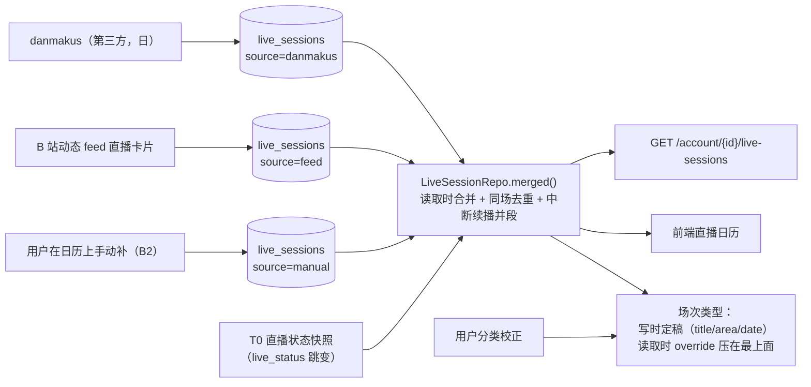

## 1. 直播场次管道（多源合一）

> ⚠️ 2026-10-12（f016，`devlog/467`）：类型从"读取时 9 类推断"改成**写时定稿**
> （`app/services/live_settle.py`），`series`/`learned` 两档下线（它们要看全账号历史，
> 与"只看这一场"冲突）；2026-10-12（T3，`devlog/468`）「健身」换成「助眠」。

- 表内场次（danmakus / feed / **manual**）+ self 快照推导的「虚拟场次」在**读取时**合并，
  不落表；合并窗口 90 分钟，同 `room_id` 去重，同标题中断续播并段；
- `end_at` 由快照/次日 danmakus 补全；收益/弹幕数来自 danmakus。

> ⚠️ **2026-10-13 量过：self 快照推导的场次"落表"这件事不要做**（`devlog/472`）。
> 真机 14 账号：快照推导 **139** 场，其中**没有表内行、需要新建行的 0 场** ——
> 它们**全部**通过 `_find_group` 挂到了已有行上。所以那一档不是"场次来源"，
> 而是**挂在场次上的观测事件**（补 `end_at`、偶尔补标题）。
> 落表的收益是 `merged()` 里省掉快照推导那一截（实测 54ms → 23ms，即
> `/live-type-stats` 92ms → 约 65ms，且只在开卡片时付一次），
> 代价是这些行会改走**行**的合并规则（`room`/`dup`/`interrupt`/`restart`），
> 而它们今天走的是 `_find_group` 的"区间重叠优先 + 端点容差"—— 两套判据不等价，
> snapshot 行没有 `room_id`、标题常为空 ⇒ 一次合并就可能把原本并成一场的**拆成两场**
> （正是 `_find_group` 当初被写出来要修的那个毛病）。**收益小、风险实**，故不做。

**读路径的两处"作用域限制"**（2026-10 落地；方案文档已随落地删除，结论留在这里）：

- **按页合并**（`devlog/459`/`460`）：
  `GET /account/{id}/live-sessions` **只合并"这一页 ± 1 页"**里的表内行与自观测快照
  （请求带 `from`/`to` 或 `month`，对外只返回窗口内那些场次），翻页时带页 id 重取重算。
  起因是"每次读都合并整段历史"：实测 155ms 里 ORM 装载 1,394 行 21ms + 分组合并 ~63ms
  全是**全历史**的成本 ⇒ 改成窗口后落到**十几毫秒量级，且不再随历史增长**。
  ⚠️ 依据是"合并是**局部现象**"这条实测结论（同场只可能与时间上挨着的分组合并）。
- **`_find_group` 的候选窗口**：自观测快照找归属组时**不扫全部快照**，只回看一个有理论依据的
  小区间（按合并窗口/端点容差推出来的 lo/hi 公式）—— 与上一条同源：合并的候选**本来就极小**。
  这也是 `devlog/472`"快照推导的场次不要落表"那条结论的前提（139 场全部挂上了已有行）。

**开播边沿的出口（M1，devlog/243）**：T0 每轮比较 `live_status` 得到 `edge` / `started`
（"开播"方向），原先**唯一**消费者是 `note_dynamics_activity()`（把动态流恢复满速）；
现在 `db.commit()` **之后**多一条 `message_hub.HUB.publish("domain.live.edge", …)`
（开播 ⇒ 顶栏出现 alert 级「XXX 开播了」）。⚠️ 顺序不能反：消息发出去收不回，
而事务可能回滚（判据 `tests/test_live_edge_notice.py::test_no_message_when_the_transaction_rolls_back`）。

**手动记录（B2，devlog/454）**：日历工具栏「+」/ 场次详情弹窗的铅笔 ⇒
`POST|PATCH|DELETE /account/{id}/live-sessions[/{live_id}]`（契约见 `docs/backend/HTTP-CONTRACT.md`）。

- **`source='manual'` 是第四种来源**，合并后与别的源拼成 `feed+manual` 这样的组合串 ⇒
  「这一场能不能改时间/能不能删」由服务端按**分词**判定（`app/domain/live_manual.py::is_manual_source`），
  响应里以 `manual` 字段给出 —— 前端不自己拆 `source`；
- 手动行**必须有 id**（`manual-<uuid4>`）：分类校正、详情/上游/词云端点全以 `live_id` 为键；
- 冲突（409）**只拦表内已有记录**的时段；只有 self 快照的时段**放行**（合并会把快照并进手动组，
  日历上仍是一条）—— 那是"给自动观测到的场次补标题/录播地址"唯一做得到的路径；
- 自动抓来的场次**只允许补录播地址**（时间/标题下次同步会被 `_upsert` 覆盖回去）；
- `vod_url` 是本表**唯一"用户手写、没有自动源"**的字段 ⇒ 合并规则里只增不减（不变量 39），
  且**组里任何一行**的地址都要算数（不变量 39 第二段）。

## 场次与第三方源不变量

> 查 danmakus **还能给什么**（观众榜 / 用户足迹 / 身份字段 / 分页与额度限制）→ `docs/backend/DANMAKUS-API.md`。

8. **外部源幂等**，且只在每日/每周低频访问第三方站点；

14. **场次合并要防「开放式区间」**：`end_at` 缺失既可能是「正在直播」也可能是「数据未定稿」，
    当无穷大会让很久以前的记录吞掉今天的场次 —— 用假定时长上界 + 双缺 end 时只认同标题
    （devlog/047）；

39. **用户手填的字段在多源合并里只增不减**（B2，devlog/454）：`live_sessions.vod_url` 是
    全表唯一**没有任何自动源**会重新给出来的列（danmakus/feed 的 upsert 从不写它）——
    而合并的高优分支是 `g.update(_row_dict(row))`，自动行那份 `vod_url` 是 `None`，
    一次合并就能把它抹掉（静默丢数据）。**四处合并**（`_merge_row_into_group` / dup /
    interrupt / restart）都要走 `_keep_vod` 兜底；判据
    `tests/test_vtuber_api.py::test_manual_vod_survives_room_merge` /
    `::test_manual_vod_survives_dup_merge`；
    ⚠️ **候选里必须带上"正在并入的这一行"自己的地址**（2026-10-15，`devlog/502`）：
    一次直播被切断成两段时本表有**两行**（并成一组），而对外 `live_id` 取的是
    `_SRC_IDS_KEY` 里**同源后写的那一行** —— 录播匹配写进去的正是那一行，并段分支只从
    **主行**取字段的话，地址就落在一个合并视图永远不看的地方。症状不是报错，而是
    **"写入成功、日历上不显示、再扫一遍还是同一批"**（真机实测 189 条里 182 条这样），
    判据 `tests/test_live_sessions.py::test_merged_segment_vod_url_from_later_row`；

40. **同一场只许有一个"代表行"带类型**（f017，devlog/471）：`live_sessions.session_key` 与
    `category`/`category_from` **只在代表行**（= `merged()` 给这个组定的对外 `live_id` 那一行）
    上有值，同组其余行三列都是 NULL。理由是"按类型查询/统计"直查 `(account_id, category)`
    索引：破了这条，`GROUP BY` 数的是**行**而不是**场次**（真机实测 123 行多算），
    而两个界面都不会报错 —— 用户只会看到卡片与日历的数字不一样。
    **补齐（物化）只许发生在启动期与写点之后**（`app/services/live_identity.py`；
    启动期在 `app/main.py::lifespan`、写点后挂在 `danmakus.sync_account` 的批量 upsert 之后
    与手动增删改的回执里）—— **读端点只读**。⚠️ 第一版把它放在读路径上（`devlog/471`），
    代价是"第一次打开最慢"（真机 `/live-sessions` 464ms 冷 vs 170ms 热），而前端恰在还没有
    任何场次时显示加载块（`devlog/473`）。启动期**只在有账号需要补时才扫**：每账号在 `app_meta`
    留 `live_identity_v<n>:<account_id>` 记号，正常启动 **<1.2ms**（旧版无条件扫 485ms）；
    **行变了的入口必须作废记号**（同步装配失败 / 手动增删改 / purge —— 漏一个的症状是
    "永久跳过、统计少算"，两处都不报错，`devlog/475`）。补齐幂等：值一样就不写。
    判据 `tests/test_vtuber_api.py::test_only_the_representative_row_carries_the_type` /
    `::test_startup_materialize_fills_old_rows_once`（含"读不写"与"第二次不写"）
    / `::test_startup_materialize_skips_marked_accounts`（跳过 + 版本失效 + 三个作废点）
    + `scripts/check_type_index_parity.py`（真机逐类等数 + 重复代表/孤儿值 = 0）；

41. **录播号列表的顺序 = 优先级，且自动匹配绝不碰已有的 `vod_url`**（2026-10-15，`devlog/497`）：
    `vtubers.vod_account_uid` 是**逗号分隔的自由字符串**（f015 起就是），**左端 = 最高优先**；
    ⚠️ 它是**每个 V 一份**（列在 `vtubers` 上），**不许跨 V 复用** —— 2026-10-15 实测
    "所有主播都显示同一个录播号"是前端那个"存完立刻回显"的覆盖值整页共用一份造成的
    （`PostsPage.vodUidOverride`，已改成带 V 的 id）；写入口两个（「录播号」小窗 /
    「添加录播」里的"记住这个号"），**归一与上限口径必须同源**（`parseMids` + 最多 5 个，
    用户 2026-10-15 拍板）——否则同一个字段两个入口互相拆台。
    扫描时逐个号与**尚未配上**的场次配对（`app/services/vod_scan.py` 的配对池逐号收窄）
    ⇒ "高优先缺漏由低优先兜底"自然成立，且**低优先不可能覆盖高优先**。
    两条推论：① 与不变量 39 同源 —— 已有 `vod_url` 的场次**既不进匹配、也不算漏配**
    （那是用户手填的，不可再生）；② `vod-scan` **只读**（一个字节都不写），
    写入只走 `vod-apply` 且**只写显式列出的 items**。
    ⚠️ **"没有合集/系列"不等于"这个号没录播"**（2026-10-15 用户实测，`devlog/504`）：
    `94009831` 的清单接口 HTTP 200 / `code=0`，但 seasons 与 series **两个列表都是空的**
    —— 它的 **1093 条录播全在投稿里**。自动挑来源必须在系列/合集为空时**退回投稿流**
    （投稿本就是三条路之一），否则整个号被误报成"没找到可扫的来源"。
    投稿流还有三处专属口径：
    **① 翻到哪一页由数据决定**（2026-10-15 用户：「按当页最后一条投稿的发布时间与最早场次
    时间之间的差值来算，最后一条早于最早的一场直播就不翻了」）——
    `scan` 把 `最早场次 − PAGE_STOP_MARGIN(1 天)` 当作 `stop_before` 塞进取数参数，
    投稿按发布倒序 ⇒ 一页里最旧的那条越过它就没必要再翻；`UPLOAD_MAX_PAGES` 退化成兜底上限；
    **② 标题和时间都不像录播的丢掉**（`tier` 不在 `UPLOAD_KEEP_TIERS` = 既没有回放词、
    也没有可读场次时间的 `weak`）—— 实机 1093 条里丢掉 23 条、翻页 22 → 19 页；
    **③ 时长在 `body_json.duration`**（`"5:34:00"`，不是顶层字段，不解析它 ⇒
    `<10 分钟丢掉`与兜底`≥30 分钟`两条前处理全部失效）、**发布时刻要归一成朴素 UTC**
    （投稿流给的是带时区的 datetime，不归一 ⇒ 与场次时刻一比就抛 `TypeError`，
    整个号 `ok=False` —— 2026-10-15 真机实测踩到）。
    ⚠️ **配对必须放在工作线程里跑**（2026-10-15，`devlog/503`）：`match_sessions` 是纯 CPU，
    满池（942 场 × 927 候选）实测 **0.7s**（取代价的线性扫描修掉之前是 **69s**）——
    在 `async def` 里直接跑会把事件循环占住，那段时间**整个后端一个请求都答不了**
    （用户实测报成"扫描时前端也被阻塞"）。取代价走排序后建的 `{(live_id, bvid): cost}` 表，
    不许退回线性扫（那是 O(n³)，池子一小看不出来、一满就炸）。
    判据 `tests/test_vod_scan.py`（优先级/兜底/已有录播不参与/★系列为空退回投稿/
    ★取数下界真的传下去）+ `tests/test_vod_api.py::test_vod_scan_never_writes_anything` /
    `::test_vod_scan_excludes_sessions_that_already_have_a_vod` +
    `tests/test_vod_source.py`（★投稿时长读 `body_json` / ★<10 分钟的投稿真的被丢掉 /
    ★翻页在下界处停 / ★不像录播的丢掉 / ★发布时刻归一）；
    等价性对照见 `_probe/vod_match_ab.py`（旧实现 vs 新实现逐条签名一致，882/882）。
    ⚠️ 这条推论成立的**前提是"写进去的那个地址合并视图看得见"**（上面不变量 39 的第二段）——
    看不见时它就永远留在池子里，用户看到的是"每次扫都是同一批"。

42. **录播地址只有清空一个出口，且它是"全清"**（2026-10-15 第三版，用户口径
    「硬性清除所有已匹配项」）：`POST /account/{id}/vod-clear` 按 `vod_url IS NOT NULL`
    取行、一次 `commit` 清掉 —— **不分类**（自动匹配写的 / 手填的 / 历史没记账的一样清）、
    **不打上游**（判据 `tests/test_vod_api.py::test_vod_clear_sends_no_upstream_request`：
    三条取数路径全换成会抛错的桩，清空照样成功）、**只清地址不删场次**。
    回执里的 `auto`/`manual`/`untracked` 只是**分类报数**（f018 的 `vod_source` 在这里
    唯一的用途）：手填的地址不可再生，所以确认窗必须先把 `manual` 的条数摆出来再让人按。
    ⚠️ 上一版只清 `vod_source='match'`，真机 693 条有地址的一条都没清掉，回执只能说
    "这些清不掉" ⇒ 用户报成"清空看着像坏的"（`devlog/502`）。

