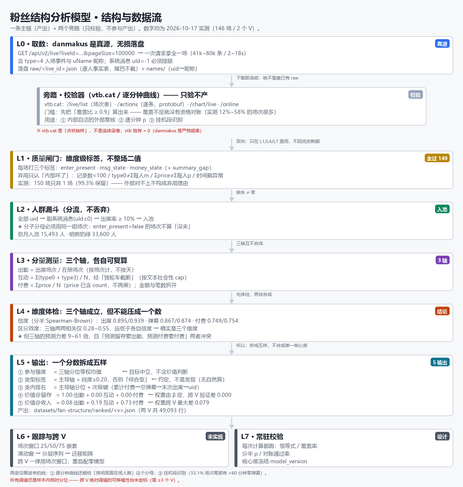

# 粉丝结构分析 · 模型与数据架构 v1.0（2026-10-17）

> **状态：数据层验证完成，模型骨架已验证，参数未定。**
> 依据从 v0.3 的**单 V 6 场**扩到 **3 个 V 共 225 场**（220 场可用），量级跨度 4~37 千弹幕/场。
>
> **定位**：这一页是**严肃数据分析工作台**，不按归档器的附属卡片设计 —— 读者是研究者本人，
> 输出要**可复算、可解释、并且知道自己边界在哪**。

## 0. 这一版

### 0.1 一句话

**逐场次**记录每个粉丝在每个主播每场直播里的三类行为，在**最近 N 场**（N = 25 / 50 / 75，嵌套三档）
窗口上算出**场均化**的出勤 / 互动 / 付费分量，经**维度体检**后合成核心度并分层；
再用**滑动窗口**把分层连成时间序列做群体跟踪，用**同一套场次窗口**把不同主播的结果并排对照。

### 0.2 进度

| 层 | 状态 | 出处 |
|---|---|---|
| 数据结构面（上游能用什么） | ✅ 已实测 | §2 |
| 主源选型与性能 | ✅ 已定，实测 8.4 分钟抓 150 场 | §2.3 |
| 验证口径（danmakus 为真源 + 内部自洽 + 外部校验） | ✅ 已定，150 场只弃 1 场 | §2.4 |
| 落盘契约（无损 + 三层 + 曲线） | ✅ 已定并落地 | §2.5 |
| **逐分钟曲线（danmakus 算 + vtb chart/online）** | ✅ **已接入 145 场** | **§2.4.4** |
| 挂机段识别 | ✅ 已实测（33.1% 场次有尾巴） | §4.5 |
| 架构（七层） | ✅ 已定 | §3 |
| 基本单位与窗口 | ✅ 已定 | §4 |
| 测量规则（三组分量） | ✅ 已定 | §5 |
| **信度 / 区分效度 / 结构 / 预测力** | ✅ **已验证** | **§6** |
| 参数与阈值 | ✅ **已定标**（纯度 0.15 / 门槛 10% / 权重 / 挂机段），仅绝对值阈值待 ≥3 个 V | §10 |
| **L5 输出形态（五样拆分）** | ✅ **已定并跑通** | **§3.5** |
| 类型数的自然性 | ❌ **验伪了：无自然簇，类型是约定** | §3.5.3 |
| 跨 V 绝对阈值可移植性 | ✅ **已验证：不可移植**（18 组交叉套用，7 组超标） | §6.5 |

### 0.3 v0.3 → v1.0 的四处实质修正（全部由实测驱动）

| # | v0.3 的说法 | v1.0 改成 | 依据 |
|---|---|---|---|
| 1 | 主源用 v3 帧翻页 | **主源改成 `danmakus /api/v2/live?pageSize=100000` 一次拿全** | 一次请求 41k~80k 条 / 2~18s，带昵称；v3 要 2~5 次翻页且更慢（§2.3） |
| 2 | 直接拿 vtb.cat 的 `Message`/`Money` 当基准 | **必须先验基准源自身的完整度**；本库 `danmakus_count` / `total_income` 其实都是 **1.00x** | 偏离场次实测是 vtb.cat 只收了 12%~58% 的时间跨度（§2.4.1） |
| 3 | 付费金额当连续分量 | **降级为标记 + 分层变量** | 入选者里 81.2% / 86.3% 是零付费（§6.2） |
| 4 | 分半 ρ ≥ 0.8 才给四层 | **保留，但换成 Spearman-Brown 全长估计** | 半长 ρ 天然低；实测 R = 0.75~0.94（§6.1） |

### 0.4 结构总览（一张图）



> 图由 `_probe/draw_model_flow.py` 生成（Pillow，可重画）。数字均为 2026-10-17 实测。
> **中间值走查** `python _probe/fan_walkthrough.py`（逐步打印 L2–L5）；**数学定义与验证报告**见 `plans/fan-model-spec.md`。

**读法**：一条**主链**（L0 → L6）负责产出；**两个旁路**（vtb.cat 汇总字段、逐分钟曲线）
只做校验，**不回流改数据**。三处关键分界决定了整个模型的性格：

| 分界 | 在哪 | 为什么这么划 |
|---|---|---|
| **无损 / 派生** | L0 ↔ L1 | L0 一个字节都不改；截断、去重、过滤**全部**是分析期的事（§2.5） |
| **验 / 判** | 旁路 ↔ L1 | 校验器只报"它没见过这段"，**不构成弃用理由**；弃用只认内部判据（§2.4.3） |
| **测量 / 输出** | L3+L4 ↔ L5 | 三轴是**测量**，可以各自成立；但**不能压成一个数**（§3.5.1） |

---

## 1. 已定口径

### 1.1 用户拍板

| # | 决定 | 日期 |
|---|---|---|
| 1 | 窗口**三档嵌套**（25 / 50 / 75 场），并支持**滑动时间窗** | 2026-10-15 |
| 2 | **逐场次**分析（不是按天/按周聚合） | 2026-10-15 |
| 3 | **结构与个体**两种产出都要 | 2026-10-15 |
| 4 | 口径修正**暂时不回写**历史数据 | 2026-10-15 |
| 5 | 工作台**单次只分析一个 V**，不扩到全库 | 2026-10-15 |
| 6 | **采集到的数据不要丢弃**（L0 必须无损） | 2026-10-17 |
| 7 | 偏差与错漏**标注而不修复**，按维度降级而非整场排除 | 2026-10-17 |
| 8 | **danmakus 是主要真来源**；其它源以它为基准做验证，**不反过来判它的罪**；**除非非常严重的偏差，不丢弃场次的弹幕数据** | 2026-10-17 |

### 1.2 数据推翻原设计的（每条都有实测依据）

| # | 原设想 | 实际 | 依据 |
|---|---|---|---|
| 1 | 本地库里有人 | **没有人** —— 只有场次聚合，fan 要从弹幕现算 | §2.1 |
| 2 | 停留时长可测 | **不可观测**，只能给下界 | §9.1 |
| 3 | 出勤按"天" | 改"按**场次**"，一天两场记 2 | §2.1 |
| 4 | 到达越早越核心 | 到达分位半长 ρ 仅 0.24~0.36 ⇒ **不是稳定特征** | v0.3 §7 |
| 5 | 重复率高就降分 | **直接等于惩罚最高频粉丝**（唯一文本率随弹幕量下降） | §5.3 |
| 6 | 金额与笔数可合并 | **必须拆开**：≤0.3 元占 73.4% 笔数但只 1.1% 金额 | §5.4 |
| 7 | 单人单场一次进入 | 入场**近一半是重复推送**，须 30s 去重 | §5.1 |
| 8 | 上游场次切分与 vtb.cat 一致 | **不一致**：danmakus 会合并短直播，vtb.cat 会拆分 | §2.4 |
| 9 | 每场都有人场事件 | **不是**：明前奶绿 4/75 场完全没有 `type=4` | §2.6 |
| 10 | 上游数据是静态的 | **会变**：同一场几小时内 `total` 从 21,826 变 12,306 | §2.6 |

---

## 2. 数据层（L0）

### 2.1 三个上游源的可观测面

| 能力 | danmakus | vtb.cat | 本库 |
|---|---|---|---|
| 逐条弹幕 + 时间戳 | ✅ | ✅ | ❌ |
| **入场事件（`type=4`）** | ✅ **唯一来源** | ❌ **没有** | ❌ |
| 昵称 | ✅ 100% | ✅ 100% | ❌ |
| 金额 / 笔数 | ✅ | ✅ | 仅聚合 |
| **勋章等级 / 勋章名** | ❌ | ✅ 90% 覆盖 | ❌ |
| **大航海等级** | ❌ | ✅ | ❌ |
| 逐分钟在线人数 | ❌ | ✅ `/online` | ❌ |
| 逐分钟弹幕条数 | ❌ | ✅ `/chart/live` | ❌ |
| 粉丝团名单 + 跨 V 分布 | ❌ | ✅ `/fansRank` | ❌ |
| 场次表（按 mid 枚举） | ✅ | ✅ | ✅ |

**⇒ 两个上游是互补的，不是二选一。** 出勤只能靠 danmakus（只有它有入场事件）；
身份与房间节奏只能靠 vtb.cat。

### 2.2 端点规格（2026-10-17 实测）

**danmakus · 主源**

```
GET https://ukamnads.icu/api/v2/live?liveId=<uuid>&pageSize=100000
  → {code, data:{total, hasMore, data:{danmakus:[...]}}}
  每条：{uId, uName, type, sendDate(毫秒), message, price?, count?}
  type: 0 弹幕 · 1 礼物 · 2 上舰 · 3 SC · 4 进入 · 11/12 系统
  ⚠️ 系统消息 uId = -1，聚合时必须排除
  ⚠️ `pageSize` 大页与分页结果一致；`pageNum` 在 20000 以上会退化
```

**danmakus · 备选（v3 帧）**：`/api/v3/lives/{liveId}/danmakus?offset=&limit=`
返回 `frame.{actors[],records[]}`，`actorId` 是**页内下标**。比 v2 慢，仅在 v2 失败时回退。

**vtb.cat · 开放面（不带 `/api` 前缀）**

| 端点 | 给什么 | 实测 |
|---|---|---|
| `/live/list?uid=<mid>&limit=1000&page=1` | 该 V 全部场次 + `Message/Money/GuardMoney/SuperChatMoney/StartAt` | 一次拿全（明前奶绿 715 场、弥月 909 场） |
| `/live/info?id=<live>` | 单场聚合 + `MsgRank`（top 100 每人条数） | <1s |
| `/actions?live=&pn=&ps=&order=time&uid=&pb=1&room=` | **逐条记录（protobuf）** | `ps=50000` 一次拿全 41,965 条 / 6s |
| `/online?id=<live>` | **逐分钟同时在线人数** | 334 点 |
| `/chart/live?id=<live>` | **逐分钟弹幕条数** | 335 点，合计 = `Message` 精确 |
| `/fansRank?liver=<mid>&size=&page=` | **粉丝团全员 + 跨 V 分布** | `total` 25,725 / `alive` 3,467 |
| `/search/uid?type=Watcher&uid=<uid>` | 单用户的勋章记录 | 1 条 |

`/actions` 的关键响应头：`x-protobuf-schema: ActionResponse`、`access-control-allow-origin: *`、无鉴权。
字段映射（wire format 手解，无需 protobuf 库）：`2`=ActionType · `3{1}`=CreatedAt(秒) · `5`=文本 ·
`6`=uid · `7`=昵称 · `8`=数量 · `9`=礼物名 · `11`=大航海等级 · `14`=Hash ·
`17/18/19/21`=勋章所属 mid/名字/等级/勋章名。

**vtb.cat 的两个坑**

- `https://vtb.cat/api/*` 被 **Cloudflare 人机验证**挡住（403 `Just a moment...`），代理也过不去；
  开放面只在 `api.vtb.cat` 的**无前缀**路径上
- `EndAt` 字段**是坏的**（实测比 `StartAt` 早 2.5 小时），**不能**用来判时间重叠；
  `StartAt` 存的是"把北京墙上时间当 UTC 的 epoch"，要按 **+08** 解释

### 2.3 主源选型：为什么是 `v2/live` 一次拿全

| 取法 | 记录 | 体积 | 耗时 | 页数 |
|---|---|---|---|---|
| v3 只取 `type=4` | 37,868 | 3.29 MB | 5.2s | 2 |
| v3 全量 | 80,014 | 7.71 MB | 15.2s | 5 |
| **v2/live `pageSize=100000`** | **80,014** | **7.19 MB** | **6.1 / 13.8 / 7.6s** | **1** |

连跑 3 次全部成功、`hasMore=False`、`uName` 覆盖 80,012/80,014。**一次请求就同时拿到了
v3 要翻页才能拿全、且 vtb.cat 根本没有的入场事件。**

**实测规模**：225 场（3 个 V × 75 场，其中明前奶绿可用 71）**0 失败**，共 8,954,317 条记录、
156 万人次、系统消息只占 0.106%。

⚠️ **吞吐与体积无关**（2026-10-17 实测）：`limit=200` 0.02 MB/s → `limit=100000` **1.97 MB/s**，
**体积越大吞吐越高**（固定开销摊薄）。所以不要为"大响应会被掐断"去设计降级阶梯 ——
那个判断来自一次站点慢窗口，是错的（§11 第 3 条）。

### 2.4 验证：danmakus 是真源，其它源只是校验器

**口径（2026-10-17 用户拍板）**：**danmakus 是主要真来源**。vtb.cat 等其它源的作用是
**以 danmakus 为基准做交叉验证、发现盲点**，**不是用来判 danmakus 的罪**。
**除非出现非常严重的偏差，否则不丢弃任何场次的弹幕数据。**

#### 2.4.1 主抓手是内部自洽，不是外部比对

| 内部恒等式 | 实测（150 场） |
|---|---|
| `type0`（场次）= Σ 每人 `m` | **150 / 150** |
| `sum_price`（场次）= Σ 每人 `p` | **150 / 150** |
| `danmakus_count`（channel 汇总）= `type0`（逐条） | 中位 **1.000** · 严格相等 **131 / 150** |
| `total_income`（channel 汇总）= Σprice（逐条） | 中位 **1.00** · ±1% 内 **133 / 150** |

**⇒ danmakus 自己的汇总字段与逐条记录高度自洽。** 这比"和别的源对得上"更硬，
因为它**不依赖第三方的完整度**。

剩下 19 场 / 17 场的汇总差（15%~55%）是**上游自己的记账差**，不等于数据坏了，
只标 `summary_gap`，不影响使用。

#### 2.4.2 外部校验的前提：先判校验器本身全不全

拿 vtb.cat 的 `Message` / `Money` 对账之前，**必须先算覆盖比**：

```
覆盖比 = vtb.cat /actions 记录的时间跨度 / danmakus 记录的时间跨度
  覆盖比 >= 0.9  → 校验器是全的 ⇒ 它的偏离**可以**用来反查我们
  覆盖比 <  0.9  → 校验器只收了片段 ⇒ **不能用它判我们**
```

**实测（逐条对齐：danmakus `type=0` vs `/actions` 的 `ActionType=1`，按 `(uid, ts±2s)` 贪心匹配）**

| 组 | 覆盖比 | danmakus 独有 | `vtb 独有` | 弹幕偏离 | 金额偏离 |
|---|---|---|---|---|---|
| 通过 · 09-13 | **99.2%** | 64 条（0.2%） | **0** | −2.6% | **+0.0%** |
| 通过 · 07-31 | **96.4%** | 470 条（1.9%） | **0** | +0.9% | **+2.3%** |
| 通过 · 08-16 | **98.5%** | 178 条（1.3%） | **0** | −0.4% | **+0.0%** |
| 偏离 · 07-24 | 58.3% | 18,614 条（96.4%） | **0** | +2640% | +3900% |
| 偏离 · 09-11 | **11.9%** | 7,018 条（86.3%） | **0** | +622% | +10547% |
| 偏离 · 09-09 | **14.6%** | 10,661 条（85.7%） | **0** | +585% | +2970% |
| 偏离 · 09-17 | 32.5% | 3,864 条（70.6%） | **0** | +225% | +675% |

**三条硬结论**

1. **`vtb 独有 = 0`（每一场）** ⇒ danmakus 是 vtb.cat 的**严格超集**
2. 多出来的**全是真弹幕**：有文本 **100%**、文本长度中位 3~5、唯一文本率 48.6%~58.5%
   （与已匹配批 55.0%~72.3% 同量级）、**高频词完全一致**（`无语` / `？` / `妈妈`），
   且**已匹配用户的 95.4% / 75.0% 也在其中说话**
3. **覆盖比与偏离一一对应**：覆盖 >=96% 时偏离 ±3%，覆盖 12% 时偏离 +622%
   ⇒ **偏离几乎全部由校验器的部分收录解释，与 danmakus 的完整性无关**

#### 2.4.3 弃用规则：只认"内部坏了"，不认"外部不一致"

| 弃用条件（全部是内部判据） | 本批命中 |
|---|---|
| 记录数 < 100（几乎没有数据） | **1 场**（08-27，仅 2 条） |
| `type0` ≠ Σ 每人 `m`（聚合恒等式破） | 0 |
| `sum_price` ≠ Σ 每人 `p` | 0 |
| 时间戳异常（跨度 > 12 小时 / 反向 / 缺字段） | 0 |

**⇒ 225 场里只弃 1 场，保留 224 场（99.6%）。**

**外部不一致不构成弃用理由，只降级**：

| 情况 | 本批 | 处理 |
|---|---|---|
| 覆盖比 < 0.9（校验器不全） | 20 | `unverified` —— **数据照用**，绝对值改用分位 |
| 覆盖比 >= 0.9 且我方更少 >10% | 5 | `short` —— 真可能缺，弹幕维度降级 |
| 仅金额偏离 | 6 | 金额只用分位 |
| 无参考（vtb 未收录） | 4 | 只进出勤维度 |

**匹配规则**（只用于"找对校验器"，不用于判罚）

```
① 基准 = 开播不晚于我们起点(+5分)、且最贴近的那一场
   （我们的 start_at 可能偏晚：实测一场 vtb 开播早 58 分钟）
② 再并上在 [基准, 我们的 end_at] 内开播的后续段
   （danmakus 会把几段短直播合并成一场，vtb.cat 分开记）
③ 右边界用精确的 end_at，不加 pad；缺 StartAt 时退回 CreatedAt
```

⚠️ 这条规则**只保证"找到了对的校验器"**，不保证"校验器是完整的" —— 后者由覆盖比单独判。

#### 2.4.4 逐分钟对账：比会话总数强得多的证据

三条曲线接进来（`_probe/fan_curves.py`，产物 `datasets/fan-structure/curves/<live_id>.json`）：

| 曲线 | 来历 | 备注 |
|---|---|---|
| **danmakus 逐分钟** 弹幕 / 入场 / 付费条数 | **从 `raw/*.json` 的时间戳序列直接算** | danmakus 没有按场的分钟曲线端点，但**不需要** —— 逐条记录已经全在手 |
| `vtb.cat /chart/live?id=` | 逐分钟 `RecordCount` | 与 `Message` 同量纲 |
| `vtb.cat /online?id=` | 逐分钟同时在线 `Count` | 覆盖通常比 chart 少几十个点 |

**实测（145 场）**

| 指标 | 结果 |
|---|---|
| **逐分钟弹幕数相关 ρ** | 中位 **0.9987** · p10 0.870 · p90 1.000 · **77% 的场次 ρ ≥ 0.99** |
| **覆盖比 vs `1/(1+dev_msg)` 的残差** | **中位 0.002** |
| vtb 缺失分钟的位置分布 | 开头 6.6% · 中间 32.4% · **结尾 61.1%**（共 16,264 分钟） |

**★★ 第二行是关键，把 §2.4.2 的归因从"相关"升级成定量等式**：

```
vt_chart_total / dm_total  ≈  1 / (1 + dev_msg)      残差中位 0.002
```

| 场次 | dev_msg | 1/(1+dev) | 实际覆盖比 | 残差 |
|---|---|---|---|---|
| 07-24 | +2639.7% | 0.037 | 0.036 | **−0.000** |
| 09-11 | +621.6% | 0.139 | 0.137 | −0.001 |
| 10-13 | +83.6% | 0.545 | 0.545 | **0.000** |

⇒ **会话级偏离 100% 由"vtb 少覆盖了哪些分钟"解释，没有其它因素。**

⚠️ **vtb.cat 是点状抽样，不是连续录像**：实测有一场 danmakus 每分钟弹幕中位 **74 条**、
直播持续 318 分钟，而 vtb 的 chart 只覆盖 **3 个分钟点**；另一场 chart 覆盖到第 269 分钟
（占跨度 98%）却只有 33 个点。⇒ 它连"部分区间"都不是，**更不能用它当基准**。

**曲线的用处不止对账**：`/online` 补上了"房间层面在场人数"这个迄今缺失的分母，
而 danmakus 的逐分钟密度可以识别挂机段（§4.5）。

### 2.5 落盘契约

```
datasets/fan-structure/pilot_v3_<v>/
  raw/<live_id>.json     逐人事实表（无损：尾巴不截、事件时间戳全留）
  names/<live_id>.json   {uid: 昵称}（按场存，能看出改名史）
  stats/<live_id>.json   场次级元数据 + 对账结果
  curves/<live_id>.json  **逐分钟曲线**（danmakus 算 + vtb chart/online），按分钟对齐
```

**`raw` 的每用户结构**

| 键 | 含义 |
|---|---|
| `m` / `mt` / `mh` | 弹幕条数 / 时间戳序列 / 文本哈希序列 |
| `e` / `et` | 入场条数 / 时间戳序列 |
| `p` / `pe` / `pt` / `pl` | 付费金额 / 笔数 / 时间戳 / 单笔金额序列 |
| `g` / `gd` / `sc` | 礼物 / 上舰 / SC 分项金额 |
| `t0` / `t1` | 该人在本场的最早 / 最晚事件 |

**三条硬规则**

1. **L0 无损** —— 不在采集时做任何截断。尾巴裁剪、去重、过滤全部是**分析期**的派生操作。
2. **`raw/` 永不覆盖** —— 采集器跳过已存在的文件。上游会漂移，覆盖等于销毁证据。
3. **修正只写派生层** —— 原始值一个字不动。

### 2.6 缺失、漂移与处置

**处置原则：不改数据，只标状态；不整场排除，按维度降级。**

每场打**维度级标签**（不是一个 `ok/deviate`）：

```json
{ "enter_present": true, "msg_state": "ok|over|under|unknown",
  "money_state": "ok|high|unknown", "ref": 2220310 }
```

**按依赖关系取用**

| 指标 | 依赖 | 缺了怎么办 |
|---|---|---|
| 出席率 / 出勤组 | `enter_present` | `false` → 该场对所有人记**未知**，**不是缺席** |
| 场均弹幕（绝对值） | `msg_state=ok` | over/under → 只用**分位/排名** |
| 付费金额 | `money_state=ok` | high → 只用**分位** |
| 付费笔数 / 付费率 | 不需要金额 | 全可用 |

**★ 规则：缺失 ≠ 零。** `enter_present=false` 的场次**绝不能**算成"这场他没来"。
操作上就是一句话：**分子分母用同一组场次**。用 150 当分母会把所有出席率统一压低 2.7%，
跨 V 比较时若两边缺场比例不同，**排序都会歪**。

**分档处置**（⚠️ 2026-10-17 修正：偏离的归因变了，处置也跟着变）

`deviate` 现在的含义是"**vtb.cat 验不了我们**"，**不是"我们的数据坏了"**（§2.4.2）。
所以处置的原则是：**验不了的不要当成错的剔掉**。

| 情况 | 场次 | 归因 | 处置 |
|---|---|---|---|
| 对账通过 | 115 | 两源一致 | `msg_state = ok` |
| 偏离且**我方更多** | 20 | vtb.cat 部分收录 | `msg_state = unverified` —— **数据照用**，绝对值改用分位 |
| 偏离且**我方更少 >10%** | 5 | 可能我们真缺 | `msg_state = short` —— 弹幕维度降级，其余照用 |
| **仅金额偏离**（弹幕吻合） | 6 | vtb 金额口径不明 | 金额只用**分位** |
| 无参考 | 4 | vtb.cat 未收录 | 只进出勤维度 |
| 记录数 <100 | 1 | 真·坏样本 | **整场剔除**（已含在"我方更少"组里） |

**实测容量（150 场，danmakus 为真源的口径）**

| 维度 | 可用场次 | 占比 |
|---|---|---|
| **保留场次（不被弃用）** | **149** | **99.3%** |
| 出勤（有入场事件） | 146 | **97.3%** |
| 弹幕·可用（`ok` + `unverified` + 仅金额偏离） | **141** | **94.0%** |
| 弹幕·绝对保票（校验器完整且一致） | 115 | 76.7% |
| 付费·金额（同 `ok`） | 115 | 76.7% |
| 付费·笔数/率（有记录即可） | 149 | 99.3% |

**⇒ 把 danmakus 定为真源之后，只有 1 场被弃用**（§2.4.3 的内部判据），
其余全部保留；差别只在于**哪些维度的绝对值能打保票**。

**入场缺失的分布**：弥月 0/75，明前奶绿 **4/75**（08-27、09-29、10-01 ×2）。
这些场次 `records` 与 `type0` 自洽，**就是没有 `type=4`** ⇒ 录制端不同。
入场/弹幕比中位 1.19（弥月）/ 0.92（明前奶绿），一旦缺失影响很大。

---

## 3. 分析层（L1–L7）

| 层 | 职责 | 一句话纪律 |
|---|---|---|
| L0 取数 | 把上游变成**无损**的逐人事实表 | 物化边界必须画死 |
| L1 质量闸门 | 每场每维度打标签 | 前置，不是事后验证 |
| L2 人群漏斗 | 分流，不丢弃 | 每一层剔除都要能审计 |
| L3 分量测量 | 只算，不合成 | 三个分量各自独立可复算 |
| L4 维度体检 | 判断"能不能合成一个数" | 未通过就不给单一核心度 |
| L5 合成与输出 | **一个分数拆成五样**（强度 / 类型 / 类内排名 / 两个效标排序） | 每个排序必须说清效标 |
| L6 跟踪与跨 V | 时间序列 + 并排对照 | 一律用场次窗口 |
| L7 常驻校验 | 恒等式 + 覆盖率 + 稳定性 | 每次跑都跑，不是发布前才跑 |

### 3.1 L1 质量闸门（已落地的形态）

见 §2.6 的维度级标签。**关键变化**：从"整场 `ok/deviate`"改成"每维度一个状态"，
因为同一个场次可以"弹幕对不上但出勤完全可用"。

### 3.2 L2 人群漏斗

```
全部观测 uid
  → 剔除 系统消息（uId ≤ 0）
  → 剔除 只出现 1 场且零互动零付费（疑似扫过）
  → 入选 = 出席率 ≥ 10%（值待扫，见 §10）
```

**每一层剔除的人数与原因必须落库**，否则无法解释"为什么这个人是外层"。

### 3.3 L3 分量测量

三组各自出数，**互不合成**。测量规则见 §5。

### 3.4 L4 维度体检

判断"核心度能不能是一个数"。**已完成的四项见 §6**。仍未做的：

- 权重敏感性（±50% 时层级重指派率 + ARI）
- 阈值敏感性（±20% 时搬家率）
- 绝对值阈值的跨 V 可移植性（§6.5）

### 3.5 L5 合成与输出：**一个分数拆成五样**

#### 3.5.1 为什么必须拆

实测（`_probe/fan_equal_weight_test.py` + `fan_weight_ci.py`，220 场·**3 V**）：用前半窗口三轴预测后半窗口结果，
**三轴的预测力差 9~61 倍**，而且方向冲突：

| 效标 | 出勤 β | 互动 β | 付费 β | 归一权重 |
|---|---|---|---|---|
| **留存** | +0.206 / +0.256 | −0.003 / −0.038 | −0.027 / −0.021 | **[1.00, 0.00, 0.00]** |
| **收入** | +0.128 / +0.196 | +0.387 / +0.367 | +1.179 / +1.903 | **[0.08, 0.19, 0.73]** |

（两组数分别是弥月 / 明前奶绿）

**⇒ 预测留存要出勤、预测付费要付费，两者冲突。不存在一组权重能同时最优。**
一个叫「核心度」的单数字会被读者当成价值判断，而它**不是**。

**权重跨 V 交叉验证**（3 个 V）：**留存稳定**（最大差 **0.069**，出勤 0.93~1.00）；**收入不稳定**（最大差 **0.157**）——见 §6.5；
收入 [0.076,0.228,0.696] vs [0.079,0.149,0.772]（最大差 **0.079** < 0.15）⇒ 不是过拟合出来的。

#### 3.5.2 五样输出

| 输出 | 定义 | 性质 |
|---|---|---|
| ① **参与强度** | 三轴分位（0~1）的**等权均值** | **目标中立**，只排"行为强度"，不含价值判断 |
| ② **类型标签** | 主导轴 + 纯度 ≥ **0.15**（§10.1），否则「综合型」 | **约定**，不是发现（§3.5.3） |
| ③ **类内排名** | 同类型内按该类型主指标排 | 同类才可比 |
| ④ **价值@留存** | `1.00·出勤 + 0.00·互动 + 0.00·付费` | 效标 = 留存 |
| ⑤ **价值@收入** | `0.08·出勤 + 0.19·互动 + 0.73·付费` | 效标 = 付费 |

**同一份名单可以带多个排序，但每个排序都必须说清"为哪个目标排"。**
仪表盘默认展示 ①+②+③；④⑤ 必须**显式选择效标**才出现。

#### 3.5.3 ⚠️ 类型是约定，不是发现（负面结果，照实记）

| 检验 | 结果 | 结论 |
|---|---|---|
| k=2..8 的轮廓系数 | **单调上升 0.512 → 0.607，没有峰值** | **没有自然簇** |
| 纯度分布（主导轴 − 次轴） | 中位仅 **0.054**（弥月）/ 0.100（明前奶绿） | **大多数人没有单一主导轴** |
| 阈值 0.20 时的类型占比（弥月） | 出勤 19% · 互动 6% · 付费 2% · **综合 73%** | 纯类型是少数 |

⇒ **类型标签必须标注为"约定"**，不能说"存在四种核心用户"。
这与 §6.3 的"付费率随出席完全平滑、无断点"是同一件事的两个侧面。

**但类型确实有效标证据**（阈值 0.20，弥月）：

| 类型 | 人数 | 后半留存 | 后半付费>0 |
|---|---|---|---|
| 出勤型 | 3,000 | **99.3%** | 3.3% |
| 互动型 | 894 | 94.2% | 6.6% |
| 付费型 | 308 | 92.5% | **17.9%** |
| 综合型 | 11,291 | 92.6% | 9.9% |

⇒ 类型在效标上**确实分开**（留存 99.3% vs 92.5%，付费率 3.3% vs 17.9%），
但**不是一条单调序** —— 出勤型留存最高、付费率最低，付费型反过来。
**这正是"不能用单一核心度排序"的又一条证据。**

#### 3.5.4 ⚠️ 极端处并列严重

出勤型前 3 名的三轴分位**完全相同**（0.996 / 0.374 / 0.428）—— 大量满勤者并列。
⇒ 输出**必须带次级排序键**（累计付费 / 末次出席 / 首发文本数），否则名单前后无序。

#### 3.5.5 两轴图仍然保留（用于"直观"）

`出席率 × 场均投入` 的二维图不变（§6.3 / §6.4 的数据仍有效），它承担"直观"这一职责；
但它只是**可视化**，不再是"层的定义"。

### 3.6 L6 跟踪与跨 V

滑动窗口 → 分层序列 → 迁移矩阵。跨 V 见 §7。

### 3.7 L7 常驻校验

每次计算都跑：恒等式（`type0 == Σ per-user m`）· 覆盖率（`enter_present` 占比）·
稳定性（分半 ρ）· 对账（`|dev| ≤ 10%` 的场次占比）。

---

## 4. 基本单位与窗口

### 4.1 逐场次的原子事实

单位是 **(uid, live_id)** 的一行，不是"人"。所有人的量都先落到这个粒度，再按窗口聚合。

### 4.2 尾窗 `W_N`

**最近 N 场**，N ∈ {25, 50, 75}，嵌套三档。**必须并列显示窗口的覆盖区间与末场日期** ——
播得勤的 V 的"25 场"可能只覆盖 3 周，播得少的可能覆盖半年。

### 4.3 场均口径

**计算与阈值用场均，展示时总量与场均并列。**

排序不受影响（同一窗口内只差常数 N），但**阈值受影响** —— 总金额口径下"金额 ≥ X"
在 75 档等于场均 ≥ X/75，比 25 档松 3 倍 ⇒ 嵌套类型学会失真。

### 4.4 嵌套窗口 → 迁移类型学

25 → 50 → 75 的层变化可以分类成"新晋 / 稳固 / 衰退 / 波动"。
这是"结构随时间如何变"的主产出。

---

### 4.5 ★ 挂机段识别：`end_at` 不是真实下播时刻

danmakus 的场次边界包含"直播结束后录制端继续录"的部分。实测（145 场）：

| 指标 | 结果 |
|---|---|
| 尾部有 **>60 分钟连续零弹幕** 的场次 | **48 / 145 = 33.1%** |
| 这些尾巴合计 | **13,145 分钟 = 219 小时**的无用跨度 |
| 最极端一场 | 跨度 1104 分钟，**空闲占比 77.4%**（尾部 854 分钟 = 14 小时） |

⇒ 任何用"**场次时长**"的量（到访率、在场密度、活跃跨度）在 1/3 的场次上都会失真。

**识别方法（不需要外部源）**：在 danmakus 自己的逐分钟曲线上找**最后一个有弹幕的分钟**，
其后连续零弹幕段即挂机段。分析期按"最后一个有弹幕分钟 + 余量"截断。

⚠️ **这是分析期操作，L0 不截** —— 原始记录全部保留（用户口径第 6 条）。
同理，`stopDate` 只作参考，不作硬边界。

## 5. 测量规则

### 5.1 清洗（三条，都有实测依据）

| # | 规则 | 依据 |
|---|---|---|
| 1 | **弹幕条数 = 全部 `type=0`**（含空文本） | 与上游 `Message` 同口径；空文本占比因场而异 |
| 2 | **入场事件按 30s 去重** | 爆发串 **48.18%** 含 ≥2 条，阈值曲线在 30s 处拐平（2.88→1.69→**1.51**→1.51） |
| 3 | **按 `stopDate` 截掉尾巴** | 尾巴中位 5.0 分钟、占记录 1.02%；**但这是分析期操作，L0 不截** |

另：`price` **已含 `count`，直接累加不再乘**（v3 时代 7/7 场逐分相等；
v2 时代用 `Money = 礼物+上舰+SC` 复核，见 §2.4）。

### 5.2 出勤组

```
出席(session)  = 该场有 type0 或 type1/2/3 记录
弱出席(session) = 该场只有 type4 记录              （不计折扣：实现里出场即计入出席，§10.2）

A1 出席率   = 出席场次数 / N
A2 连续度   = 该 V 场次序列上的最长连续出席段 / N    ← 按场次序号相邻，不按自然日
A3 到达分位 = median( 他进场时该场已入场人数的比例 )
A4 到达稳定 = IQR( 同上 )
A5 末次位置 = median( 末次事件在该场事件时间轴上的位置 )
```

⚠️ **A3/A4/A5 半长 ρ 只有 0.22~0.36 ⇒ 不进合成，只作描述**（§6.1 的同批实测）。

### 5.3 互动组

```
I1  场均互动条数 = Σ(type0 + type3条数) / 出席场次           主项
I1a 弹幕条数 = Σ type0 / N                                  分解
I1b SC 条数  = Σ type3 / N                                  分解
I2  发言广度 = 有(type0 或 type3)的场次数 / N
I3  活跃跨度 = mean( max(mt) − min(mt) ) / 该场时长          仅 ≥2 条，下界
I4  文本特征 = {唯一文本率, 最大重复}                       只展示
```

**SC 按条数计入、不按金额**（金额属付费组，否则互动组会变成付费组的影子）。
⚠️ 2026-10-17 起**已实现**（`fan_backfill_paid.py` 用 `type=1&2&3` 过滤补采了分类型条数，
101 KB/场 vs 全量 7 MB）。但实测 SC 只占弹幕 **0.41%** ⇒ 对排序几乎无影响；
它真正的价值是**不再漏计"只用 SC 互动"的人**（这类人极少，见 §5.3 末）。
**I4 只在 `type=0` 上算**：SC 文本几乎必然唯一，混进来会抬高唯一率、恰好把独轮车埋掉。

**独轮车截断**

```
计入 I1 的条数 = Σ_文本 min(该用户对该文本的条数, cap)
    cap = K（大，如 10）  若说该文本的不同用户数 ≥ S   ← 全场共有的仪式，豁免
    cap = k（小，如 2）   若说该文本的不同用户数 <  S   ← 只有他在说 ⇒ 独轮车
```

⚠️ **剔除不可逆** ⇒ 留痕 · 可审计 · 保守（宁可漏判不可错杀；`K/k/S` 要扫不能拍）。

### 5.4 付费组

```
P1 场均金额   = Σ price / N                        主项，但只用于分位
P2 节点付费率 = 节点场次付费次数 / 节点场次出席次数   分母 < 3 标不可测
P3 付费广度   = 有付费的场次数 / N
P4 舰队等级   = 单场金额档位取最高                  展示（定类）
P5 笔数       = Σ 笔数 / N                         与金额并列，不进合成
```

**特殊节点 = `category ∈ {special, 3d}`**，依据：`special` 均收益 21,206（18.7×）、
`3d` 14,808（13.1×），对比 `live` 1,132。
★ **不循环**：`category` 是**写时按标题/分区/起播时刻推出来的**，与收益无关。

⚠️ 另两条路走不通：`birthday` / `debut_date` 全库全 `None`；`vtuber_events` 只有 1 条。

**地板价不需要设**：礼物 ≤0.3 元占 **73.4% 笔数但只 1.1% 金额**，>100 元贡献 **73.6%** 金额
⇒ **金额与笔数必须拆成两个分量**。

### 5.5 不进合成的

| 量 | 为什么 |
|---|---|
| 停留时长（点估计） | 不可观测（§9.1） |
| 到达分位 / 末次位置 | 半长 ρ 仅 0.22~0.36（§6.1） |
| I4 文本特征 | 判据未验证，进乘数会惩罚高频粉（§5.3） |
| P5 笔数 | 衡量点击次数，不是投入 |
| P4 舰队等级 | 定类量，与 P1 高度相关 |

---

## 6. 验证（220 场 / 3 V 实测，2026-10-17）

> 数据：弥月 75 场（可用 75）· 明前奶绿 75 场（可用 71）。
> 分半按**奇偶场**，入选者 = 出席率 ≥ 10%。

### 6.1 信度：三个分量都达标

| V | 指标 | n | 半长 ρ | **全长 R** | 判读 |
|---|---|---|---|---|---|
| 弥月 | 出席率 | 9,182 | 0.809 | **0.895** | 稳 |
| 弥月 | 场均弹幕 | 9,182 | 0.766 | **0.867** | 稳 |
| 弥月 | 场均付费 | 9,182 | 0.599 | 0.749 | 可用 |
| 明前奶绿 | 出席率 | 22,120 | 0.884 | **0.939** | 稳 |
| 明前奶绿 | 场均弹幕 | 22,120 | 0.775 | **0.874** | 稳 |
| 明前奶绿 | 场均付费 | 22,120 | 0.605 | 0.754 | 可用 |
| **星瞳** | 出席率 | 18,502 | 0.848 | **0.918** | 稳 |
| **星瞳** | 场均弹幕 | 18,502 | 0.763 | **0.865** | 稳 |
| **星瞳** | 场均付费 | 18,502 | 0.511 | 0.676 | 可用 |

**两个 V 的数值几乎一样** ⇒ 这三个量不是噪声。付费最低（0.75），那是**付费稀疏**造成的，
不是测量问题。

⚠️ **半长 ρ 不能直接当门槛用** —— 它天然低（折半了）。要比就比 **Spearman-Brown 全长 R**。

### 6.2 区分效度：三个分量确实是三个东西

| 相关 | 弥月 | 明前奶绿 |
|---|---|---|
| 出席率 ↔ 场均弹幕 | 0.412 | 0.408 |
| 出席率 ↔ 场均付费 | 0.337 | 0.280 |
| 场均弹幕 ↔ 场均付费 | **0.554** | 0.415 |

**三者相关 0.28~0.55，远低于各自信度 0.75~0.94。**

这条是模型成立的关键证据：若三个分量之间也相关到 0.8+，那就是**同一个东西算三遍**，
加权相加毫无意义。实际不是。

**付费稀疏性（决定它不能当第三轴）**

| V | 零付费占比 | 付费者内部分位（p25 / 中位 / p75 / p95） |
|---|---|---|
| 弥月 | **81.2%** | 0.01 / 0.02 / 0.12 / 9.00 |
| 明前奶绿 | **86.3%** | 0.01 / 0.01 / 0.11 / 7.48 |

⇒ **付费降级为标记 + 分层变量**，不参与连续合成。

### 6.3 结构：扇形，不是"两个簇"

出席率越高，投入的分布越**摊开**：

| 出席率 | "0 条"占比 | "5-20 条 + >20 条"占比 |
|---|---|---|
| <2% | **99.0%** | 0.1% |
| 2-10% | 94.4% | 0.4% |
| 10-30% | 78.0% | 1.0% |
| 30-60% | 53.7% | 2.8% |
| >60% | **26.1%** | **15.1%** |

⇒ 不是"两个核心"的孤立簇，是**出席率决定"是不是粉丝"、投入在同一梯度上分化**。

### 6.4 预测力：最强的一条，且跨 V 复现

用**前半窗口**分层，预测**后半窗口**的实际行为：

| 层 | 弥月 人数 | 付费率 | 人均付费 | 明前奶绿 人数 | 付费率 | 人均付费 |
|---|---|---|---|---|---|---|
| **核心** | 2,172 | **34.1%** | **¥50.97** | 4,279 | **33.1%** | **¥55.62** |
| 偶尔爆发 | 1,706 | 14.8% | ¥4.82 | 4,135 | 11.2% | ¥5.85 |
| **在场型** | 1,903 | 5.7% | ¥0.64 | 4,309 | 10.4% | ¥2.45 |
| 外层 | 9,712 | 2.4% | ¥0.17 | 20,877 | 3.1% | ¥0.33 |

**四条结论**

1. **排序在两个 V 上完全一致**（核心 > 偶尔爆发 > 在场型 > 外层）⇒ 跨 V 可复现的结构
2. **核心层人均付费是外层的 170~300 倍** ⇒ 分层有真实经济意义
3. **在场型显著比外层值钱**（付费率 2~3 倍、人均 3~7 倍）⇒ **"来了但不说话的人"是真实且有意义的群体**
4. ★ **"偶尔爆发"人均付费高于"在场型"**（¥4.82 vs ¥0.64；¥5.85 vs ¥2.45）
   ⇒ **出席率高但沉默，价值不如"来得少但每次都很投入"** —— 这是对"只看出席率"的最强反驳，
   也正是两轴模型的必要性所在

### 6.5 跨 V 绝对值阈值：**已验，结论是"不可移植"**

上一版这里写的是"没有证明"。2026-10-17 加了第三个 V（星瞳，均弹幕 37,462 / 均收益 18,854，
是另两个的 3~14 倍）之后，这一项**已验完**（`_probe/fan_calibrate_abs.py`）。

**三轴绝对值的差距**（p75，入选者）：出席率 **0.413 / 0.465 / 0.360**（1.3×）；
**场均弹幕 0.10 / 0.143 / 0.417（4.2×）**；**累计付费 0 / 0 / 0**。

**交叉套用**（拿 A 的 p75 套到 B，理想应都 ≈25%）：18 组里 **7 组偏离超 8 个百分点（39%）**。
最不可移植的是场均弹幕（星瞳阈值套到弥月只剩 15.0%，反向是 41.4%）；累计付费在三 V 的 p75
**都是 0** ⇒ 绝对金额阈值在中位数以下毫无意义，要用只能取**付费者内部**分位。

**⇒ 必须每 V 分位数化。「跨 V 比核心度绝对值」列为禁区**，只能比层级/排序（与 §7 纪律 3 一致）。

**权重分两种命运**（`fan_weight_ci.py`，bootstrap 1000 次）：
**留存** [1,0,0]·[1,0,0]·[0.931,0,0.069]，最大差 **0.069** ⇒ ✅ **可用统一权重**；
**收入** [0.076,0.228,0.696]·[0.079,0.149,0.772]·[0.131,0.072,0.798]，最大差 **0.157** ⇒ ❌ **必须每 V 自校准**。

★ **机制**：互动权重 **0.228 → 0.149 → 0.072** 单调递减，对应房间弹幕量 **4.5k → 28k → 37k**
⇒ **房间越吵，"发弹幕"越没有区分度**，对预测付费的边际价值越低。这不是噪声，
也说明"一套权重走天下"在原理上不成立。
## 7. 跨主播对照

同一 uid 在每个 V 上各有一份自己的窗口结果。输出：**核心度向量 · 足迹 · 主推识别 ·
广泛度 · 错位**（在 A 是核心、在 B 只是外层）。

**三条纪律**

1. 跨 V 一律用**场次窗口** —— "近 25 场"对每个 V 的粉丝是**同等机会**
2. 每个 V 的窗口**必须并列显示覆盖区间与末场日期**
3. ⚠️ 单 V 内 `log1p` 不归一 ⇒ **核心度数值不可直接跨 V 比大小**，但**层级可以比**

### 7.1 重叠关系必须配零模型

"A 与 B 的核心群体重叠 300 人"**不可解释** —— 两个主播的受众本来就有天然交集。

| 输出 | 定义 |
|---|---|
| 实际重叠 | `|A ∩ B|` |
| **期望重叠** | 超几何期望（在"所有被观测用户"池子里，按两边名单规模算） |
| **lift** | 实际 / 期望（或 Jaccard） |
| **不对称比例** | `|A∩B|/|A|` 与 `|A∩B|/|B|` **分别给** |

⚠️ 池子的选择本身是口径决定，**必须写死一个并说明理由**。
⚠️ 同企划/常联动的 V 之间重叠天然更高，那不是粉丝结构的发现。

★ **vtb.cat `/fansRank` 的 `group` 字段给了一条更硬的轴**：粉丝团成员在其他 V 的勋章分布
（实测明前奶绿：本间 3,467、灰泽满 527、七海 488、雫るる 475……）。
这是**付费身份口径**的重叠，比"出现过"硬得多，且不需要两边都抓明细。

---

## 8. 产出

| 类别 | 输出 |
|---|---|
| **结构** | 各层人数与占比 · 占比随时间曲线 · 核心层换血率/半衰期 · 嵌套窗口迁移类型学 |
| **个体** | 核心度排行（场均 + 总量并列）· 单人详情（分量分解 + 每个取值 + 历史轨迹）· 跨 V 足迹 |
| **群体跟踪** | 迁移矩阵 · 进出名单（带行为变化归因） |
| **校验** | 覆盖率 / 恒等式 / 稳定性 / 对账通过率 |

### 8.1 展示标签层（**不进分类、不进合成**）

进合成的量必须**稳定**；标签衡量的是**极端或稀有的单一事实**（"这个窗口每场都来"不保证
下个窗口还成立）⇒ 标签只描述"做过什么"，不描述"有多核心"。落盘在 `ranked/*.json` 的 `tags`。

| 标签 | 条件 | 实测占比 |
|---|---|---|
| **满勤** / 常驻 | 逐场都出席 / 出席率 ≥90% 但未满勤 | — |
| 新面孔 | 首次出现落在窗口最后 25% | 0.3~0.7% |
| **每场SC** / SC常客 / 大额SC | ≥80% 场次打 SC / ≥10 场打过 / 累计 ≥¥1,000 | 1·10·7 / 34~50 / 少 |
| **大额打米** / 千元户 | 累计付费进池内前 1% / ≥¥1,000 | **1.00%** / 0.08~0.32% |
| 提督+ / 舰长 | `guard_top` 分级（取自 `type=2` 的 `message`，**不靠价格推断**） | 6~48 / 131~1,349 |
| **纯黑听** / 几乎不言 / 话痨 | 出席 ≥10 场且从未发弹幕 / 发言场次占比 <10% / 场均弹幕进池内前 1% | 13~27% · 19~35%（**宽**）· **1.00%** |

有标签的人占 **23.9%~37.4%**。⚠️ **SC 行为的三条实测否定**：① **"只用 SC、其他克制"不成立** ——
SC 用户在场均弹幕（高 50~500 倍）、发言率（5~7 倍）、出席率（3 倍）上**全面领先**，"纯 SC" 只有 2/44/39 人；
② **"每场规律打 SC"不成立** —— ≥80% 场次的只有 0/12/7 人；③ **SC 场次率在 SC 用户内部信度仅
0.41/0.24/−0.02（噪声）**，金额/笔数同样（0.34/0.30/−0.05）⇒ **SC 只能当二元标记，不能当连续轴。**
**每个结论必须能追溯到准入条件** —— 写"N=115（金额对账通过）"而不是"N=150"。

---

## 9. 科学性边界

### 9.1 ❌「停留时间」不可观测

弹幕帧只有 `ts / type / uid / payload`，**没有任何观看时长**。`type=4` 是一次进入事件。
能构造的只有下界 `可见在场跨度 = max(ts) − min(ts)`；对"进房看一眼就走"和
"看 4 小时一句话不说"给的是同一个数。⇒ **只做减法不做加法**。

### 9.2 ⚠️ 底部一层是截断样本

沉默观看者完全不可见。所谓"路人层"是**"被观测到的轻度参与者"**，不是"路人"。
（vtb.cat `/online` 的逐分钟在线人数可以给出**房间层面**的在场规模，
但**不能**给出个人的在场时间。）

### 9.3 ⚠️ 入场事件并非每场都有

实测明前奶绿 **4/75 场完全没有 `type=4`**。这些场次里"来没来"根本测不出来，
只能算"说没说话"。⇒ 出勤分析必须先过 `enter_present` 闸门（§2.6）。

### 9.4 ⚠️ 上游数据会漂移且不可复现

同一场几小时内 `total` 从 21,826 变 12,306，而两次 `hasMore` 都是 `False`。
⇒ 抓取必须落盘并记 `fetched_at`，结论带上快照版本。

### 9.5 ⚠️ 统计稳定性必须量化

分半信度（§6.1）· 敏感性（权重 ±50% / 阈值 ±20% 的层级重指派率 + ARI）。

### 9.6 ⚠️ 构念风险：重复率判据惩罚的可能是最投入的人

实测唯一文本率随弹幕量**下降**（3-10 条 0.667 → >50 条 0.306），最大重复从 2 升到 **31**。
⇒ "重复率高就降分"直接等于惩罚最高频的粉丝（§5.3）。

### 9.7 ⚠️ 口径必须冻结

模型一旦启用**不许原地重算**：每次计算落 `model_version` 并保留旧结果。
与本仓「场次类型写时定稿」（不变量 40）同源 —— 换算法把历史结论改了，两处会各说各话，
**没有任何东西会变红**。

### 9.8 验收线

| 检查 | 通过线 | 不通过 |
|---|---|---|
| 三方对账 `|dev_msg|` | ≤ 10% | 标 `deviate`，该维度降级 |
| 出勤可用率 | ≥ 95% | 停，先查录制端 |
| **分半 R（全长）** | **≥ 0.75** | 展示"不稳定"，不给四层 |
| 区分效度 | 分量间 `|ρ|` < 0.7 | 合并该两个分量 |
| 敏感性 | 阈值 ±20% 搬家率 ≤ 30% | 降成两档 |
| 预测效度 | 层的付费率排序稳定且跨 V 一致 | 回炉改模型 |

---

## 10. 参数

### 10.1 已定（2026-10-17 定标，`_probe/fan_settle_params.py` + `fan_weight_ci.py`）

| 参数 | 取值 | 怎么定的 | 稳定性 |
|---|---|---|---|
| **入选门槛** | **10%**（召回模式 5%） | 扫 2~30%：信度 0.845~0.896、Δ付费率 42~45%，**几乎平坦** ⇒ 统计不约束，是**语义选择** | 降门槛只多纳路人，不改排序 |
| **类型纯度阈值** | **0.15** | 扫 0.05~0.40：Δ付费率在 0.15 达峰（42.8%），最薄类型（付费型）479 人；0.10~0.30 区间平坦 | ±20% → 类型不变 95.3~96.4% · ARI **0.84~0.87** |
| **参与强度权重** | **等权** `[1/3,1/3,1/3]` | 目标中立，不拟合任何效标 | 单轴 ×1.5 → ρ **0.995~0.999** · 前 10% 重合 **96.5~97.9%** |
| **价值@留存权重** | **`[1.00, 0.00, 0.00]`** | 三个 V 归一后 [1.000,0,0] / [1.000,0,0] / [0.931,0,0.069] | **稳定**（最大差 0.069 < 0.15）⇒ 可采用统一权重 |
| **价值@收入权重** | **每 V 自校准**（不跨 V 固定） | 弥月 `[0.076,0.228,0.696]` · 明前奶绿 `[0.079,0.149,0.772]` · 星瞳 `[0.131,0.072,0.798]` | ⚠️ 最大差 **0.157** > 0.15；**互动权重 0.228→0.149→0.072 单调递减，恰好对应房间弹幕量 4.5k→28k→37k** —— 房间越吵，"发弹幕"的区分度越低 |
| **挂机段判定** | 尾部连续 **>60 分钟零弹幕** | 实测 48/145 场（33.1%）命中，合计 219 小时 | —— |
| **`stopDate` 异常阈值** | 15 分钟 | 最后一条记录比它晚 4.8~5.0 分钟属正常 | —— |

### 10.2 已从模型移除（不再是参数）

| 原参数 | 为什么移除 |
|---|---|
| 乘数上下界 `[0.5, 2.0]` | L5 重写后**不再有乘数** —— 三轴各自取分位后线性组合 |
| 节点集合 `{special, 3d}` | 同上：付费轴不再做"节点付费率"分解 |
| 节点付费率分母下限 | 同上 |
| 弱出席折扣 `0.25` | 实现里从未使用；出勤按"出场即计" |
| **独轮车 `K / k / S`** | **实测任何组合都截断 8.9%~27.3% 的弹幕**（762,864 条样本），而"重复到底是独轮车还是情绪"**缺少外部效标** ⇒ **默认关闭**，只作诊断字段（`repeat_truncated`）暴露，不进主轴 |

### 10.3 ⚠️ 上一版的两个"推翻"

| 上一版说法 | 实测 |
|---|---|
| 上舰价档要靠价格区间推断（`168/198/1598/3196` 是什么价） | ✅ **`type=2` 的 `message` 字段直接就是等级名**：`舰长`（138/168/198 三种计费）、`提督`（1998）。**不要再靠价格推断** |
| SC 有 4 / 8 元档 | ✅ 实测 3 场只出现 **¥2 / 30 / 50 / 100**；`¥2×20` 是活动低价 |

## 11. 待办

| # | 事项 | 卡在哪 |
|---|---|---|
| 2 | ~~补采 `payloadKind` / `roomEmojiId`~~ **不需要** | 2026-10-17 复验：v2 的 `message` 对表情给的是 `[表情包名]`，**哈希能区分**（空文本哈希 **0.00%**、157,614 个不同哈希）。"\u8868\u60c5\u584c\u7f29" 是 **v3 时代**的旧结论（v3 的表情 `rawText` 为空），**已作废** |
| 3 | **L6 时间动态**（滑动窗 / 迁移矩阵 / 半衰期） | 只有设计，零实现 |
| 4 | ~~房间节奏归一~~ **实测无收益，不做** | 2026-10-18 实测（`_probe` 一次性量完）：单场弹幕总量极差 11.5× / 114.5× / **850.7×**，但**按场次总量归一后**互动轴排序 $\rho = 0.9984/0.9991/0.9907$，**分半信度完全相同**（0.803/0.803、0.800/0.800、0.718/0.721）。⇒ 归一几乎不改变任何人的相对位置，却把语义从"你说得多"变成"你占了房间多少注意力"（依赖他人行为）。**建议不接。** |

## 12. 不做的事

- ❌ 不自建弹幕原文库（35~48 GB 量级，本需求只用得到聚合）
- ❌ 不用 `user-analysis-jobs`（单用户 1MB + 10s，上万人/场不可行）
- ❌ 不逐人打 `users/{uid}/bootstrap`（请求数 = 粉丝数）
- ❌ 不改动 `danmaku_cloud` 的现有词云路径
- ❌ 不用单一数字回答"这个 V 的粉丝质量高不高" —— 分层是**结构**，不是分数
- ❌ 不把"停留时间"当事实展示；不把榜单前 1000 名当成"粉丝总体"
- ❌ **不为"大响应会被掐断"设计降级阶梯** —— 实测吞吐随体积单调上升（§2.3）
- ❌ **不把任何"汇总字段"当无条件基准** —— 先验那个源自身的完整度（§2.4.1 的反面教材）
